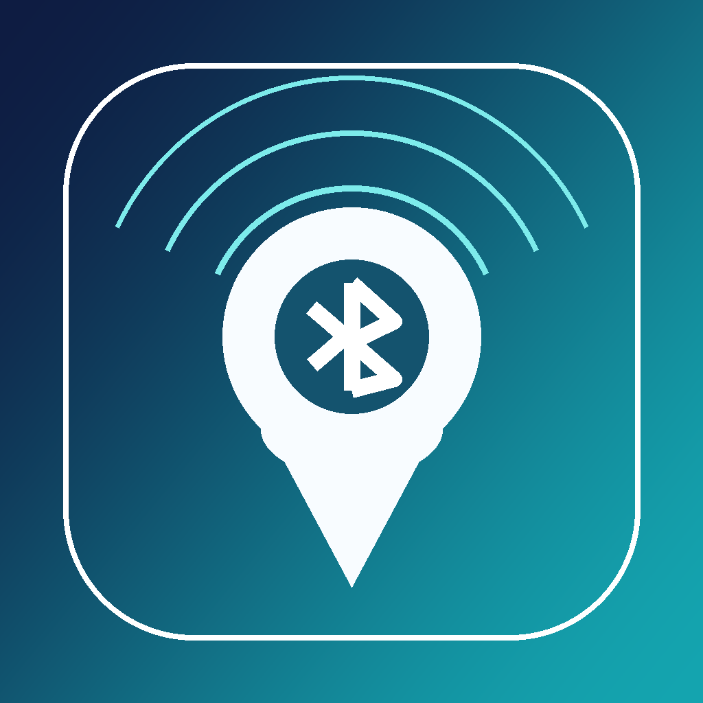

# SignalTrail

SignalTrail is a Bluetooth Low Energy scanner and observation logger for iPhone and iPad. It supports iOS and iPadOS 15.2 or later and is written in Swift, built with SwiftUI, UIKit, CoreBluetooth, Core Location, MapKit, WidgetKit, and UserNotifications. The five main screens use SwiftUI, with native Liquid Glass controls on iOS 26 and standard controls on earlier systems. Device inspection, session maps, and editors remain UIKit flows.

SignalTrail includes configurable heuristic alert profiles for broadcasts resembling:

- Axon/TASER devices
- Meta/Ray-Ban smart glasses
- Apple Find My Offline Finding accessories
- Flipper Zero devices
- HC-03/HC-05/HC-06 serial modules sometimes associated with payment-card skimmers
- Flock/Penguin devices exposing the historical battery-service pattern

These are evidence-based matches, not authenticated device identities. A matching broadcast can be incomplete, spoofed, reused by another product, or affected by firmware changes.





The app was written to investigate passive surveillance techniques, digital fingerprinting and identification, and the hidden wireless environment connecting smart cities, homes, and workplaces.

## Build requirements

- Xcode 26.0 or later (required to compile the native Liquid Glass APIs)
- iOS or iPadOS 15.2 deployment target
- A physical iPhone or iPad for BLE scanning
- An Apple development team selected under `Signing & Capabilities`

## Run

1. Open `SignalTrail.xcodeproj`.
2. Select the **SignalTrail** target.
3. Change the bundle identifier if needed.
4. Select your development team under `Signing & Capabilities`.
5. Run on a physical iPhone or iPad.
6. Review the first-run introduction.
7. Grant Bluetooth access when scanning. Grant location access when starting a recorded session.

The iOS Simulator cannot perform normal nearby BLE scans. Use a physical device for scanning; the Simulator is still suitable for unit tests.

Xcode may write the selected development team or signing identity into `project.pbxproj`. These values are intentionally local-only. Configure the repository hook once per checkout:

```sh
git config core.hooksPath .githooks
```

Before every commit, the hook removes personal team, certificate, and provisioning-profile values from Xcode project files and stages the sanitized project file. The same check can be run manually with `scripts/sanitize-xcode-signing.sh --stage`.

## Features

### Scanning and sessions

- First-run guidance for Quick Scan, Record Session, and location data
- A readiness checklist for Bluetooth, Location, and Notifications
- Timed Quick Scans, set to two minutes by default
- Recorded sessions with configurable scanning and pause intervals; scan bursts default to seven seconds
- Repeated advertisement logging, including the timestamp, RSSI, advertisement fields, and the phone's location
- Optional bounded, read-only automatic GATT enrichment during recorded sessions
- Live search, filters, sorting, minimum RSSI thresholds, and signal-strength indicators
- Session maps with clustered observation markers, the phone's route, timeline scrubbing, and playback
- Session export in JSON or CSV format
- Automatic recovery of interrupted session counts and end times from valid JSONL records on the next launch
- A Hunter tab for tracking one selected device by live RSSI, with faster sound and haptic pulses as its signal grows stronger
- A WidgetKit summary for recent sessions, device counts, signal counts, and active-recording state

### Devices and Bluetooth data

- Scan results that show useful details, such as the device name, inferred company or profile, signal age, observation count, and status, before raw identifiers
- Device summaries with expandable technical sections and tap-to-copy raw values
- Device connections, service discovery, characteristic reads and writes, and notifications
- Bluetooth SIG company-name lookup using the bundled `company_identifiers.yaml`
- Context-aware names for Bluetooth SIG services, characteristics, descriptors, units, member UUIDs, and standards-organization UUIDs
- Optional automatic, read-only GATT enrichment during Quick Scan for a bounded number of connectable devices, plus explicit user-driven inspection
- Enrichment using GAP Appearance, Device Information, Battery, HID, and selected capability values, including structured PnP ID decoding
- Decoding for selected Bluetooth SIG characteristics, including identity strings, Battery Level, Heart Rate, HID metadata, cycling, running, Fitness Machine, and environmental data. Raw bytes remain available.
- GATT navigation that clearly separates observed advertisements, values reported by the device, and inferred categories
- A **Hunt this device** action in device details that assigns the device to Hunter and starts proximity tracking

### Hunter feedback

- A generated sonar-style alert tone with deep and bright alternatives
- Independent sound on/off and haptic strength controls in Settings
- Duplicate-advertisement scanning and the RSSI-to-pulse timing from OUI-SPY Foxhunter
- A five-second signal timeout so stale readings stop feedback

Hunter uses the CoreBluetooth peripheral UUID because iOS does not expose a BLE
hardware MAC address. RSSI is useful for relative direction finding, but walls,
reflections, phone orientation, device transmit power, and antenna placement all
affect it. Physical-device testing is required.

### Library and alerts

- Saved devices with nicknames, notes, and matching metadata
- Alerts that can match an iOS peripheral identifier, Bluetooth SIG company identifier or name, advertised-name substring, manufacturer-data prefix, advertised service UUID, or derived Bluetooth member UUID name
- Alert enable and disable controls, status counts, recent matches, plain-language previews, and a test action before saving
- Alert templates available from live scan results, device details, recorded sessions, and saved devices
- Default alerts for Axon/TASER identifiers and names, Apple Find My Offline Finding-like broadcasts, Flipper Zero service UUIDs, Flock/Penguin battery-like broadcasts, HC-03/HC-05/HC-06 serial-module names, and Meta/Ray-Ban identifiers
- Alert edits, enable/disable changes, and deletions take effect during an active scan without resetting notification cooldown history
- Versioned default-alert migrations add new bundled rules without restoring rules the user deleted or overwriting rules the user modified
- A confirmed **Delete all local data** action removes sessions, detections, cached device details, saved devices, alert rules, settings, onboarding state, and widget data; bundled default alerts are then restored

All data stays on the device. Unit tests cover alert matching and session persistence.

## Important platform limits

- CoreBluetooth does not expose a BLE hardware MAC address on iOS. SignalTrail uses the app-scoped `CBPeripheral.identifier` and advertisement data instead.
- Each map marker shows where the phone observed an advertisement. It does not show the BLE device's verified location.
- Record Session uses application-level scan bursts. It is not raw RF sniffing, and iOS controls the radio's scan intervals.
- The MVP deliberately stops scanning when the app enters the background. This avoids implying reliable continuous monitoring that iOS does not guarantee for an unrestricted device scan.
- Company identifier and company-name alerts only work when the peripheral includes manufacturer data with a Bluetooth SIG company identifier.
- Company identifiers, member UUIDs, names, Appearance values, and GATT identity values come from the device or an assigned namespace. They do not prove who made the device or identify its exact product model.
- Automatic enrichment is available independently for Quick Scan and recorded sessions. It is limited to connectable peripherals, one connection at a time, and a per-scan device cap.
- Automatic enrichment reads only a limited allowlist of standard readable characteristics and never writes or enables notifications. Manual inspection can read, write, or subscribe when the characteristic supports it.
- GATT writes can alter device behavior, so characteristic writes are grouped under Advanced tools and require confirmation.
- A device opened from session replay cannot reconnect from stored data alone. Connection controls become available only after the same peripheral identifier is observed again in a live scan.

## Data storage

Application Support contains:

```text
SignalTrail/
├── alert-rules.json
├── alert-rules-seed-state.json
├── devices/
│   └── <peripheral-id>.json
├── known-devices.json
└── sessions/
    ├── <session-id>.session.json
    └── <session-id>.detections.jsonl
```

SignalTrail appends each observation as one JSON object per line. This avoids rewriting a large JSON array whenever it receives an advertisement and leaves a clear migration path to GRDB or SQLite.

Settings are stored separately in `UserDefaults` under the app's `SignalTrail.AppSettings` key using a versioned Codable envelope. Legacy unversioned settings migrate when read; data from an unknown future schema is not overwritten.

At launch, the store performs a best-effort, idempotent recovery pass over session metadata. Valid detections repair stale counts and close interrupted sessions at the last valid detection timestamp. Malformed, truncated, and foreign-session JSONL records are ignored.

The app also publishes a compact recent-session snapshot to the `group.com.intervalmedia.DiscoveraBLE` App Group for the WidgetKit extension. The widget does not scan independently.

## App structure

The app presents five tabs:

- `Scan` provides Quick Scan, Record Session, permission checks, filters, sorting, minimum RSSI controls, and device search.
- `Hunter` provides live signal guidance for a selected device.
- `Sessions` provides recorded-session replay, map playback, and export.
- `Library` contains saved devices and detection alerts.
- `Settings` contains scan timing, permissions, and reset actions.

## Project layout

See [`ARCHITECTURE.md`](ARCHITECTURE.md) for responsibilities, data flow, completed MVP remediation, and the detailed improvement backlog.

## Current improvement backlog

- [ ] TODO: Move all `LocalStore` file I/O behind a serial worker or actor so large-session recovery, exports, and metadata reads cannot block the main thread.
- [ ] TODO: Introduce repository and scanner protocols throughout `AppEnvironment` so view models and UI flows can use deterministic fakes.
- [ ] TODO: Add UI tests for onboarding, permission states, active-scan alert edits, session replay, and replay-device rediscovery.
- [ ] TODO: Add physical-device regression coverage for simultaneous GATT observers, connection cancellation, notification subscriptions, and replay reconnection.
- [ ] TODO: Add session rename, tags, notes, retention controls, and bulk deletion.
- [ ] TODO: Move session indexing and cross-session queries to SQLite/GRDB when real-world data volumes exceed the JSONL design envelope.
- [ ] TODO: Add an in-app storage-health and recovery report instead of silently ignoring every malformed persistence record.
- [ ] TODO: Localize user-facing strings and add accessibility audits for VoiceOver, Dynamic Type, and sufficient contrast.
- [ ] TODO: Add widget deep links and explicit empty/error states when App Group data is unavailable or stale.

## Contributing

Keep changes narrowly scoped. Use short, imperative commit subjects such as `Add session export validation`.

When changing testable logic, run:

```sh
xcodebuild -project SignalTrail.xcodeproj -scheme SignalTrail -destination 'platform=iOS Simulator,name=<installed simulator>' test
```

Note any required on-device BLE verification in the pull request.

## OUI-SPY device heuristics

Device summaries and built-in alerts now include the OUI-SPY Axon/TASER BLE
heuristic (`axonTaser`). Meta/Ray-Ban detection requires Luxottica manufacturer
data together with the Meta advertised service, or a matching Ray-Ban,
Wayfarer, or Oakley Meta name. Single Meta identifiers no longer trigger this
profile. These matches suggest a device family; they do not verify a model.

New installations use the Axon profile in the default alert. Saved alert rules
and enable/disable choices are preserved. To use the new Axon profile in an
existing installation, set an alert's built-in detector criterion to `axonTaser`.
See [OUI-SPY attribution and review](THIRD_PARTY_NOTICES.md) for the source
revisions, license status, and iOS limitations.
